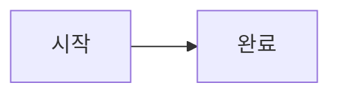

# S11 S12 혼합 문서

__CommonMark 굵게__ · ~GitHub 취소선~ · ~~이중 취소선~~

==강조== ++삽입++ ^위첨자^ <sub>아래첨자</sub> <sup>위첨자</sup> <ins>밑줄</ins>

:smile: :+1: :thumbsup: :shipit: :unknown_name: \:smile:

원문 유지: ... -- --- (c) (r) (tm) "따옴표"

용어 A
용어 **B**
: 첫 번째 정의 :smile:

    두 번째 문단 [웹 열기](https://example.com).

    - 중첩 목록
: 다른 정의

::: caution 사용자 지정 주의
일반 callout은 앱의 오류 배너가 아닙니다.

::: note 중첩 안내
본문 **굵게**와 ==강조==.
:::
:::

> [!NOTE]
> GitHub NOTE 본문

> [!TIP]
> GitHub TIP 본문

> [!IMPORTANT]
> GitHub IMPORTANT 본문

> [!WARNING]
> GitHub WARNING 본문

> [!CAUTION]
> GitHub CAUTION 본문

<details>
<summary>펼칠 내용</summary>

숨겨진 본문 표시

[상대 문서 열기](target.md)


<details open>
<summary>중첩 내용</summary>

중첩 본문을 접었다 펼쳐도 방문 상태를 유지합니다.
</details>

```kotlin
// emoji/typography/style 변환 없음
val source = ":smile: ==mark== ... --"
```

수식 $x^2 + 1$.


</details>

<details open>
<summary>처음 펼친 내용</summary>

문서의 open 표기를 적용합니다.
</details>

| 확장 | 기본 |
| --- | --- |
| ==강조== :smile: | **굵게** |

- [x] 읽기 전용 task

[웹 열기](https://example.com)

[상대 문서 열기](target.md)

## 긴 본문

본문 위치 확인 01. 기본 Markdown과 GitHub 표현을 유지합니다.

본문 위치 확인 02. 기본 Markdown과 GitHub 표현을 유지합니다.

본문 위치 확인 03. 기본 Markdown과 GitHub 표현을 유지합니다.

본문 위치 확인 04. 기본 Markdown과 GitHub 표현을 유지합니다.

본문 위치 확인 05. 기본 Markdown과 GitHub 표현을 유지합니다.

본문 위치 확인 06. 기본 Markdown과 GitHub 표현을 유지합니다.

본문 위치 확인 07. 기본 Markdown과 GitHub 표현을 유지합니다.

본문 위치 확인 08. 기본 Markdown과 GitHub 표현을 유지합니다.

본문 위치 확인 09. 기본 Markdown과 GitHub 표현을 유지합니다.

본문 위치 확인 10. 기본 Markdown과 GitHub 표현을 유지합니다.

본문 위치 확인 11. 기본 Markdown과 GitHub 표현을 유지합니다.

본문 위치 확인 12. 기본 Markdown과 GitHub 표현을 유지합니다.

본문 위치 확인 13. 기본 Markdown과 GitHub 표현을 유지합니다.

본문 위치 확인 14. 기본 Markdown과 GitHub 표현을 유지합니다.

본문 위치 확인 15. 기본 Markdown과 GitHub 표현을 유지합니다.

본문 위치 확인 16. 기본 Markdown과 GitHub 표현을 유지합니다.

본문 위치 확인 17. 기본 Markdown과 GitHub 표현을 유지합니다.

본문 위치 확인 18. 기본 Markdown과 GitHub 표현을 유지합니다.

본문 위치 확인 19. 기본 Markdown과 GitHub 표현을 유지합니다.

본문 위치 확인 20. 기본 Markdown과 GitHub 표현을 유지합니다.

본문 위치 확인 21. 기본 Markdown과 GitHub 표현을 유지합니다.

본문 위치 확인 22. 기본 Markdown과 GitHub 표현을 유지합니다.

본문 위치 확인 23. 기본 Markdown과 GitHub 표현을 유지합니다.

본문 위치 확인 24. 기본 Markdown과 GitHub 표현을 유지합니다.

본문 위치 확인 25. 기본 Markdown과 GitHub 표현을 유지합니다.

본문 위치 확인 26. 기본 Markdown과 GitHub 표현을 유지합니다.

본문 위치 확인 27. 기본 Markdown과 GitHub 표현을 유지합니다.

본문 위치 확인 28. 기본 Markdown과 GitHub 표현을 유지합니다.

본문 위치 확인 29. 기본 Markdown과 GitHub 표현을 유지합니다.

본문 위치 확인 30. 기본 Markdown과 GitHub 표현을 유지합니다.

## 지원 밖·오입력

==미완성 ++미완성 ^미완성

\==escape== \:smile:

> [!UNKNOWN]
> 일반 인용으로 유지합니다.

::: unknown
알 수 없는 일반 컨테이너 표기는 읽을 수 있게 남깁니다.
:::

<div>일반 HTML 실행은 S15까지 보류합니다.</div>

<details>
<summary>잘못 닫힌 컨테이너</summary>

끝까지 원문 보존 — 주변 문서를 버리지 않습니다.
