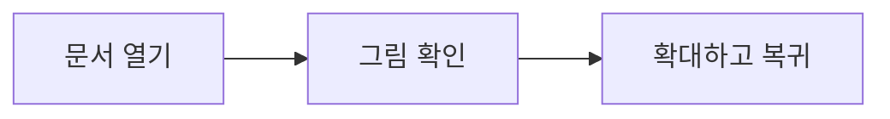

# 이미지 혼합 예제 · S08+S09

파일을 연 뒤 아래 첫 그림 위치에서 **이미지 폴더 연결**을 눌러 이 문서가 들어 있는 `MDive-S08` 폴더를 선택하세요. 폴더 선택을 취소해도 이 본문은 유지됩니다.

## PNG · 한글과 공백 경로


그림은 탭하면 확대됩니다. 아래로 스크롤했다 돌아와도 준비된 픽셀을 다시 사용합니다.

## JPEG


## WebP


## GIF · 첫 프레임


## SVG · 정적 도형


## 웹 그림 · HTTPS


## 부분 실패 · 본문 유지

파일 없음: 

허용 범위 밖: 

지원 밖: 

안전하지 않은 SVG: 

잘못된 이미지: 

HTTP 차단: 

## 혼합 본문 회귀

- [x] 읽기 전용 task
- **강조**와 ~~취소선~~

| 표현 | 값 |
| --- | --- |
| 인라인 수식 | $x^2+1$ |

```kotlin
val message = "이미지와 코드"
```

$$\frac{1}{2}$$



## 스크롤 끝

이 문단까지 내려갔다 첫 그림으로 돌아가 캐시를 확인하세요. S10 링크 이동은 아직 연결하지 않았습니다.
