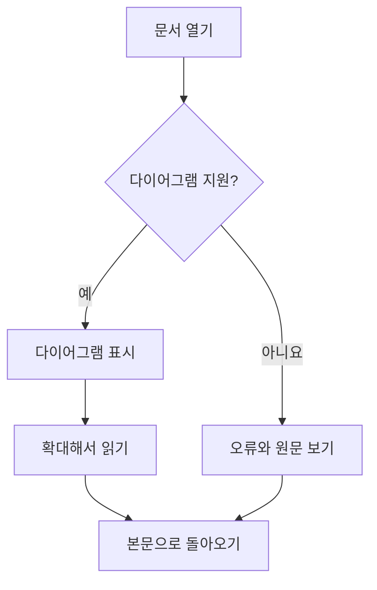
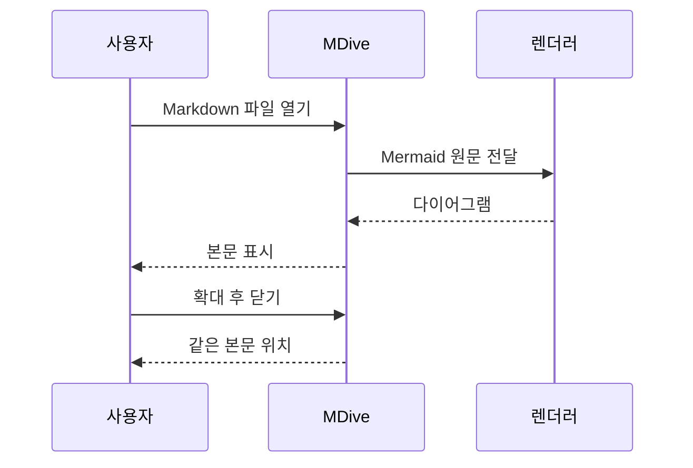
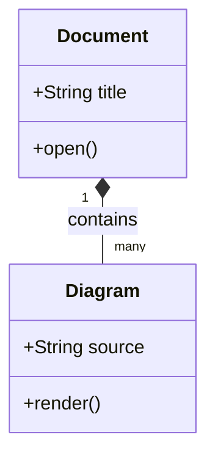
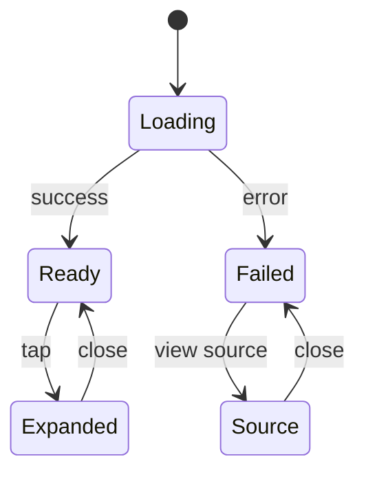
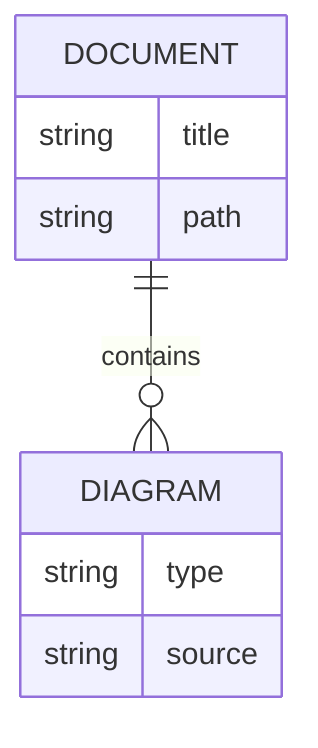
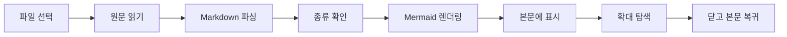
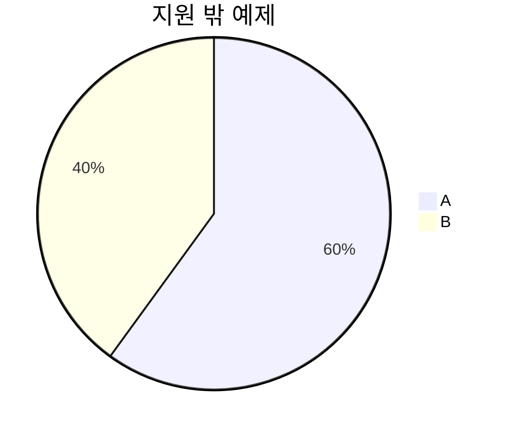

# Mermaid 직접 확인

MDive에서 이 파일을 열어 다이어그램을 확인하세요.
정상 그림을 탭하면 확대 화면이 열립니다.
원문 시트는 아래로 내려 닫아 보세요. 확대 화면에서는 두 손가락 확대·축소, 이동, 맞춤, 닫기와 시스템 뒤로를 확인하세요.

## 1. 흐름도



## 2. 시퀀스



## 3. 클래스



## 4. 상태



## 5. ER



## 6. 가로로 긴 그림

전체 그림을 맞춰 본 뒤 확대하고 좌우로 이동해 보세요.



## 7. 잘못된 구문 — 오류가 정상

아래 블록은 오류 안내와 원문 보기로 표시되어야 합니다.

```mermaid
flowchart TD
    A[닫히지 않은 노드
```

## 8. 지원 밖 종류 — 오류가 정상

S07에서는 pie를 지원하지 않습니다. 오류 안내에서 원문을 확인하세요.



## 9. 수식과 일반 코드 혼합

인라인 수식 $x_1^2 + y_1^2$ 뒤에도 본문이 이어집니다.

$$\frac{1}{2} + \sqrt{4}$$

```kotlin
val message = "Mermaid와 일반 코드를 구분합니다"
println(message)
```

일반 코드는 원문 복사가 가능하고 Mermaid 확대와 구분되어야 합니다.

**마지막 본문입니다.** 실패한 그림이 있어도 여기까지 읽을 수 있어야 합니다.
